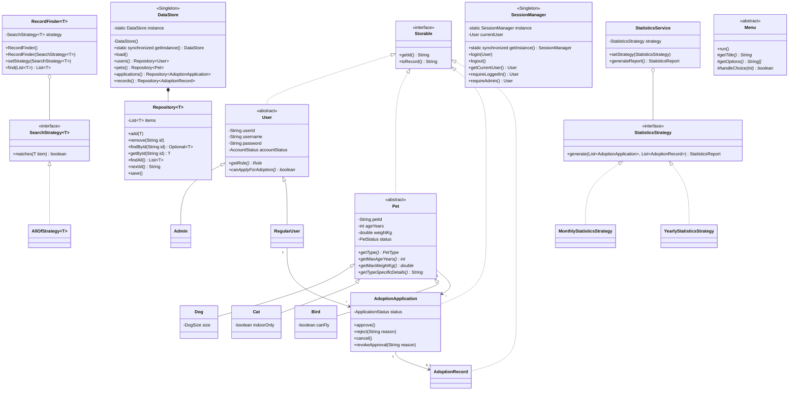
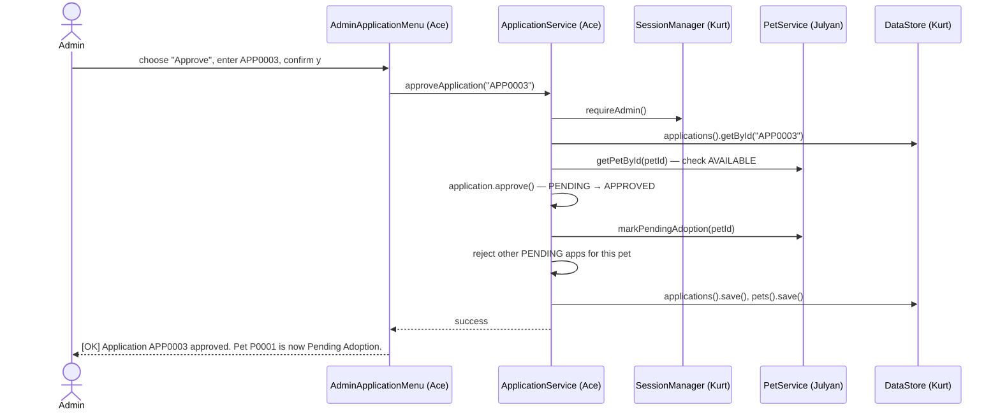

# Architecture

How the system is put together. **Planned — no code exists yet.** Class and method names here are the agreed
contract; if code ends up different, update this file in the same change.

Related: [BLUEPRINT.md](BLUEPRINT.md) (every file + signatures), [MAP.md](MAP.md) (where files live), [DATA-MODEL.md](DATA-MODEL.md) (fields, files),
[TEAM.md](TEAM.md) (who calls whom), [DECISIONS.md](DECISIONS.md) (why).

---

## Layers

```
┌───────────────────────────────────────────────────────────────────────┐
│ PRESENTATION — Menus and screens (extend ui.Menu)                     │
│   Read input only through util.InputHelper; print through ConsoleUI.  │
│   Catch PetAdoptionException and print it. No business rules here.    │
├───────────────────────────────────────────────────────────────────────┤
│ SERVICE — AuthService, PetService, ApplicationService, UserService,   │
│           RecordService, StatisticsService                            │
│   All business rules, role/ownership checks, status changes.          │
│   Throw PetAdoptionException subclasses. Never print.                 │
├───────────────────────────────────────────────────────────────────────┤
│ MODEL — User/Admin/RegularUser, Pet/Dog/Cat/Bird,                     │
│         AdoptionApplication, AdoptionRecord, enums                    │
│   Private fields, validating setters, status methods.                 │
├───────────────────────────────────────────────────────────────────────┤
│ PERSISTENCE — DataStore (Singleton) → Repository<T> → FileStorage     │
│   In-memory lists, loaded at startup, saved after every change.       │
└───────────────────────────────────────────────────────────────────────┘
        SessionManager (Singleton) — the logged-in user, used by services
```

Rules:
- A layer calls only the layer below it (menus → services → models/DataStore). Models never call services.
- Services may call other members' services (contracts in [TEAM.md](TEAM.md#contracts)).
- Only `FileStorage` touches files.

## Startup and main loop

1. `Main.main` calls `DataStore.getInstance().load()` — reads all four files. Bad lines are skipped with a
   warning. If `data/` cannot be created or read, print the error and exit.
2. `AuthService.ensureDefaultAdmin()` — seeds `admin`/`admin123` if no admin exists (ADR-007).
3. `new WelcomeMenu().run()` — Login / Register / Exit.
4. After login, `SessionManager` holds the user. `WelcomeMenu` opens `AdminMenu` or `UserMenu` by role.
5. Logout clears the session and returns to `WelcomeMenu`. Exit ends the program.
6. `Main` wraps everything in a top-level `try/catch (Exception)` so an unexpected error prints a message
   instead of a stack trace, and a `finally` that closes the input.

---

## Class diagram (planned)



Menus (`WelcomeMenu`, `UserMenu`, `AdminMenu`, `PetAdminMenu`, `PetBrowseMenu`, `UserApplicationMenu`,
`AdminApplicationMenu`, `ProfileMenu`, `UserManagementMenu`, `AdoptionRecordMenu`, `StatisticsMenu`) all extend
`Menu` and are left out of the diagram to keep it readable. Full list: [MAP.md](MAP.md).

---

## Four pillars of OOP

Each pillar must be easy to point at during the defense. "Who" is the member who owns the example.

| Pillar | Where | Who |
|---|---|---|
| **Encapsulation** | All model fields `private`. Setters validate with `Validator` and throw `ValidationException`. No setters for IDs, username, role, or `dateCreated`. `AdoptionApplication` has no `setStatus` — only `approve()`/`reject()`/`cancel()`/`revokeApproval()`. `Repository.findAll()` returns an unmodifiable list. | Everyone; status methods: Ace |
| **Abstraction** | Abstract classes `User`, `Pet`, `Menu`. Interfaces `Storable`, `SearchStrategy<T>`, `StatisticsStrategy`, `RecordParser<T>`. Menus call `ApplicationService.approveApplication(...)` without knowing how files are written. | Kurt (`User`, `Menu`, interfaces), Julyan (`Pet`), Derick (`StatisticsStrategy`) |
| **Inheritance** | `User` → `Admin`, `RegularUser`. `Pet` → `Dog`, `Cat`, `Bird`. `Menu` → every menu. `PetAdoptionException` → 7 subclasses. | Kurt, Julyan, everyone (menus) |
| **Polymorphism** | *Overriding:* `Pet.getMaxAgeYears()` / `getMaxWeightKg()` / `getTypeSpecificDetails()` differ per subclass and are used by validation and the Pet Passport. `User.canApplyForAdoption()` (Admin → false). `Menu.handleChoice()` per menu. `toRecord()` per entity. Every `SearchStrategy` / `StatisticsStrategy` implementation. *Overloading:* `InputHelper.readInt(prompt)` and `readInt(prompt, min, max)`; `readText(prompt)` and `readText(prompt, min, max)`. | Julyan (Pet), Kurt (User, InputHelper), Derick (statistics), everyone (menus, strategies) |

---

## Design patterns (GoF)

### Singleton — `core.DataStore` and `auth.SessionManager` (Kurt)

Both have a `private` constructor, a `private static` instance field, and `public static synchronized
getInstance()` that creates the instance on first call (lazy initialization), exactly like the module's
`Counter` example plus `synchronized` (ADR-034).

**Thread safety (defense answer).** The basic lazy Singleton is not thread-safe: two threads could both see
`instance == null` and create two objects. Our console app has one thread, so this cannot happen, but
`getInstance()` is `synchronized` anyway so only one thread can enter it at a time. Faster alternatives from the
module: double-checked locking with a `volatile` field, or an enum Singleton.

- **Why `DataStore`:** there must be exactly one copy of the data in memory. Two copies would overwrite each
  other's saves.
- **Why `SessionManager`:** exactly one logged-in user at a time, reachable from every service for role and
  ownership checks.

### Strategy — search/filter and statistics

**Search and filter (all record types).**
- Strategy interface: `core.SearchStrategy<T>` — `boolean matches(T item)`.
- Concrete strategies: one small class per search or filter, in each domain's `search` subpackage
  (e.g. `pet.search.PetTypeFilter`, `user.search.UserEmailSearch`, `application.search.ApplicationStatusFilter`,
  `record.search.RecordDateRangeFilter`).
- Combining filters: `core.AllOfStrategy<T>` holds a list of strategies and matches only when all match
  (spec: "multiple filters may be used").
- Context: `core.RecordFinder<T>` — holds the current strategy. Constructors `RecordFinder()` and
  `RecordFinder(SearchStrategy<T>)`; `setStrategy(...)` swaps it; `find(list)` returns matching items.
- **Every search goes through the context (ADR-032).** Each service that searches keeps a
  `private final RecordFinder<T> finder` and its `search(strategy)` method does `finder.setStrategy(strategy)`
  then `finder.find(...)`. There is no shortcut that skips `RecordFinder`.
- Runtime swap, as in the module's `Sorter` example: the user searches pets by keyword
  (`new PetKeywordSearch("aspin")`), then filters by type (`new PetTypeFilter(PetType.DOG)`). The same
  `PetService` finder swaps strategy each time.
- **Why:** the screen chooses the filter at runtime; adding a new filter is a new class, with no `if/else` chain
  to edit.

**Adoption statistics (Derick).**
- Strategy interface: `record.StatisticsStrategy` — `StatisticsReport generate(applications, records)`.
- Concrete strategies: `MonthlyStatisticsStrategy(year, month)`, `YearlyStatisticsStrategy(year)` (yearly shows
  a per-month breakdown).
- Context: `record.StatisticsService` — constructors `StatisticsService()` and
  `StatisticsService(StatisticsStrategy)`, `setStrategy(...)`, `generateReport()`. `StatisticsMenu` creates the
  strategy the admin picks (monthly or yearly) at runtime.
- Report contents: applications received, approved, rejected, cancelled, still pending, and adoptions
  completed (records) in the period.

---

## Exception handling

```
Exception
└── PetAdoptionException                (checked, base for all app errors)
    ├── ValidationException             bad field value (has getFieldName())
    ├── AuthenticationException         login failed / disabled account
    ├── UnauthorizedAccessException     wrong role for this action
    ├── RecordNotFoundException         ID does not exist (or is not yours)
    ├── DuplicateRecordException        username/email taken, duplicate application, second record
    ├── InvalidStatusTransitionException action not allowed in the current status
    └── DataFileException               file read/write/parse problem (wraps IOException)
```

Where each Java exception-handling feature appears (so it is easy to show the professor):

| Feature | Where |
|---|---|
| Custom exception classes | `exception` package (Kurt) |
| `throw` / `throws` | Every service method and validating setter |
| `try` / `catch` | `Menu.run()` catches `PetAdoptionException`; `InputHelper` catches `NumberFormatException` and `DateTimeParseException` |
| Multiple catch blocks (specific first, `Exception` last) | `Main`: `catch (DataFileException e)` then `catch (Exception e)` |
| **Nested try-catch** | `Repository.load()`: outer `try` per file, inner `try` per line (ADR-031) |
| Re-throw with context | `Repository.load()` outer `catch` adds the file name and re-throws a `DataFileException` with the cause |
| Multi-catch | Parsers: `catch (NumberFormatException \| ArrayIndexOutOfBoundsException \| IllegalArgumentException e)` |
| `try`-with-resources | `FileStorage` with `BufferedReader` / `BufferedWriter` |
| Exception chaining | `throw new DataFileException("Could not save pets.txt", ioException)` |
| `finally` | `Main` closes the input in `finally` |
| Top-level safety net | `Main` catches any unexpected `Exception` and prints `[ERROR] Something went wrong: ...` |

Rules: services throw, menus catch. Never swallow an exception silently (empty `catch`). Never show a stack
trace to the user. Never catch `Throwable` or `Error`.

### Checked vs unchecked (defense answer)

All custom exceptions are **checked** because each one is a **recoverable condition** — the program tells the
user what went wrong and continues. This follows the module's rule: checked for recoverable conditions,
unchecked for programming errors. The only unchecked exceptions are the JDK's own (`NumberFormatException`,
`DateTimeParseException`, `IllegalArgumentException`, `ArrayIndexOutOfBoundsException`,
`NoSuchElementException`); each is caught where it happens and turned into a re-prompt or a skipped line. Full
table: ADR-033 in [DECISIONS.md](DECISIONS.md).

---

## Persistence

- `Repository<T extends Storable>` is created by `DataStore` with: file name, ID prefix, and a
  `RecordParser<T>` (`T parse(String[] fields) throws PetAdoptionException`) supplied by the owning domain:
  `User::fromRecord`, `Pet::fromRecord`, `AdoptionApplication::fromRecord`, `AdoptionRecord::fromRecord`.
- `load()` uses **nested try-catch** (ADR-031):
  - outer `try`: `FileStorage.readLines(file)`; `catch (DataFileException e)` → re-throw a new
    `DataFileException("Could not load " + fileName, e)`;
  - inner `try` (inside the loop, one per line): split → parse → add; `catch (PetAdoptionException e)` → add a
    warning ("users.txt line 4 skipped: ...") and continue with the next line.
- `save()`: map every item with `toRecord()` → `FileStorage.writeLines(file, lines)` (rewrites the whole file).
- **Every service method that changes data calls the matching repository's `save()` before returning.** A
  change that touches two entities (e.g. approve → application + pet) saves both.
- Objects returned by `findById` are the live in-memory objects. Change them through their setters/status
  methods, then `save()`.

---

## Key flow: approving an application



If any check fails, the service throws (e.g. `InvalidStatusTransitionException`) before anything is changed or
saved, and the menu prints `[ERROR] ...`.
