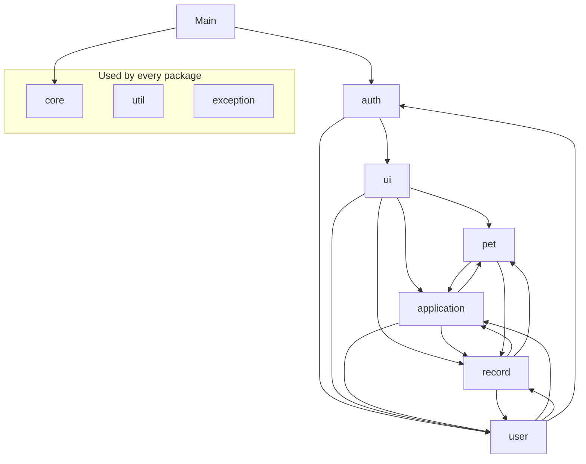

# App blueprint — file architecture

The complete planned file structure of the Java application: every folder, every `.java` file, who owns it,
what kind of type it is, what it extends or implements, and its fields and method signatures.

**Status: Kurt's files exist (branch `kurt/foundation`); everyone else's are planned.** This is the blueprint the team builds from. When a file is
created, tick it in the [checklist](#build-checklist). When code differs from this blueprint, the code wins:
update this file in the same commit.

- Signatures marked **★** are cross-member contracts and also appear in [TEAM.md §Contracts](TEAM.md#contracts).
  Change both together and tell the members who call them.
- Field rules (lengths, regexes) are in [VALIDATION.md](VALIDATION.md); file layouts are in
  [DATA-MODEL.md](DATA-MODEL.md); status rules are in [BUSINESS-RULES.md](BUSINESS-RULES.md).
- Bodies are not shown on purpose. Members write the code.

---

## Repository tree

```
ooprog-group2-finals/
├── README.md  AGENTS.md  CLAUDE.md  PROJECT-BRIEF.md  .gitignore
├── docs/                                   shared documentation (this file lives here)
├── members/{kurt,julyan,ace,derick}/docs/  per-member agent context
├── out/                                    compiled .class files (git-ignored, created by javac)
├── data/                                   runtime data (git-ignored, created by the app)
│   ├── users.txt
│   ├── pets.txt
│   ├── applications.txt
│   └── records.txt
└── src/
    └── petadoption/
        ├── Main.java                              Kurt   entry point
        │
        ├── core/                                  Kurt   persistence + Strategy base
        │   ├── Storable.java                      interface
        │   ├── RecordParser.java                  interface (functional)
        │   ├── FileStorage.java                   class (static utility)
        │   ├── Repository.java                    class (generic)
        │   ├── DataStore.java                     class — SINGLETON
        │   ├── SearchStrategy.java                interface — STRATEGY
        │   ├── AllOfStrategy.java                 class — STRATEGY (combines filters)
        │   └── RecordFinder.java                  class — STRATEGY CONTEXT
        │
        ├── auth/                                  Kurt   login, register, session
        │   ├── SessionManager.java                class — SINGLETON
        │   ├── AuthService.java                   class (service)
        │   └── WelcomeMenu.java                   class extends Menu
        │
        ├── ui/                                    Kurt   menu framework + home menus
        │   ├── Menu.java                          abstract class (Template Method)
        │   ├── UserMenu.java                      class extends Menu
        │   └── AdminMenu.java                     class extends Menu
        │
        ├── util/                                  Kurt   input, validation, output
        │   ├── InputHelper.java                   class (static utility)
        │   ├── Validator.java                     class (static utility)
        │   ├── TextRule.java                      interface (functional)
        │   └── ConsoleUI.java                     class (static utility)
        │
        ├── exception/                             Kurt   custom checked exceptions
        │   ├── PetAdoptionException.java          extends Exception
        │   ├── ValidationException.java           extends PetAdoptionException
        │   ├── AuthenticationException.java       extends PetAdoptionException
        │   ├── UnauthorizedAccessException.java   extends PetAdoptionException
        │   ├── RecordNotFoundException.java       extends PetAdoptionException
        │   ├── DuplicateRecordException.java      extends PetAdoptionException
        │   ├── InvalidStatusTransitionException.java  extends PetAdoptionException
        │   └── DataFileException.java             extends PetAdoptionException
        │
        ├── user/
        │   ├── User.java                          Kurt   abstract class implements Storable
        │   ├── Admin.java                         Kurt   class extends User
        │   ├── RegularUser.java                   Kurt   class extends User
        │   ├── Role.java                          Kurt   enum
        │   ├── AccountStatus.java                 Kurt   enum
        │   ├── UserService.java                   Derick class (service)
        │   ├── ProfileMenu.java                   Derick class extends Menu
        │   ├── UserManagementMenu.java            Derick class extends Menu
        │   └── search/                            Derick
        │       ├── UserKeywordSearch.java         implements SearchStrategy<User>
        │       ├── UserRoleFilter.java            implements SearchStrategy<User>
        │       └── UserStatusFilter.java          implements SearchStrategy<User>
        │
        ├── pet/                                   Julyan
        │   ├── Pet.java                           abstract class implements Storable
        │   ├── Dog.java                           class extends Pet
        │   ├── Cat.java                           class extends Pet
        │   ├── Bird.java                          class extends Pet
        │   ├── PetType.java                       enum
        │   ├── Gender.java                        enum
        │   ├── PetStatus.java                     enum
        │   ├── VaccinationStatus.java             enum
        │   ├── DogSize.java                       enum
        │   ├── PetService.java                    class (service)
        │   ├── PetDisplay.java                    class (static utility: pet table + Pet Passport)
        │   ├── PetAdminMenu.java                  class extends Menu
        │   ├── PetBrowseMenu.java                 class extends Menu
        │   └── search/
        │       ├── PetKeywordSearch.java          implements SearchStrategy<Pet>
        │       ├── PetTypeFilter.java             implements SearchStrategy<Pet>
        │       ├── PetBreedFilter.java            implements SearchStrategy<Pet>
        │       ├── PetGenderFilter.java           implements SearchStrategy<Pet>
        │       ├── PetAgeRangeFilter.java         implements SearchStrategy<Pet>
        │       ├── PetStatusFilter.java           implements SearchStrategy<Pet>
        │       └── PetVisibleToUsersFilter.java   implements SearchStrategy<Pet>
        │
        ├── application/                           Ace
        │   ├── AdoptionApplication.java           class implements Storable
        │   ├── ApplicationStatus.java             enum
        │   ├── LivingSituation.java               enum
        │   ├── RejectionReason.java               enum
        │   ├── ApplicationService.java            class (service)
        │   ├── ApplicationDisplay.java            class (static utility: list + details)
        │   ├── ApplicationFormScreen.java         class (form, not a menu)
        │   ├── UserApplicationMenu.java           class extends Menu
        │   ├── AdminApplicationMenu.java          class extends Menu
        │   └── search/
        │       ├── ApplicationStatusFilter.java   implements SearchStrategy<AdoptionApplication>
        │       ├── ApplicantNameSearch.java       implements SearchStrategy<AdoptionApplication>
        │       └── ApplicationPetSearch.java      implements SearchStrategy<AdoptionApplication>
        │
        └── record/                                Derick
            ├── AdoptionRecord.java                class implements Storable
            ├── RecordService.java                 class (service)
            ├── AdoptionRecordMenu.java            class extends Menu
            ├── UserHistoryMenu.java               class extends Menu
            ├── StatisticsStrategy.java            interface — STRATEGY
            ├── MonthlyStatisticsStrategy.java     class implements StatisticsStrategy
            ├── YearlyStatisticsStrategy.java      class implements StatisticsStrategy
            ├── StatisticsReport.java              Java record (result object)
            ├── StatisticsService.java             class — STRATEGY CONTEXT
            ├── StatisticsMenu.java                class extends Menu
            └── search/
                ├── RecordAdopterSearch.java       implements SearchStrategy<AdoptionRecord>
                ├── RecordPetSearch.java           implements SearchStrategy<AdoptionRecord>
                ├── RecordDateRangeFilter.java     implements SearchStrategy<AdoptionRecord>
                └── RecordPetTypeFilter.java       implements SearchStrategy<AdoptionRecord>
```

### File count

| Owner | Files | Packages |
|---|---|---|
| Kurt | 32 | `petadoption`, `core`, `auth`, `ui`, `util`, `exception`, `user` models |
| Julyan | 20 | `pet`, `pet.search` |
| Ace | 12 | `application`, `application.search` |
| Derick | 20 | `user` services/menus, `user.search`, `record`, `record.search` |
| **Total** | **84** | |

Kurt has the most files, but most are small (8 exceptions, 3 interfaces, 2 enums). Kurt's files are needed first.

---

## Package dependencies

Arrows mean "uses". `core`, `util`, `exception`, and `ui` are used by every package, so they are drawn once.



Cycles between `pet`, `application`, `record`, and `user` are fine in Java (they compile together). They exist
only through **service** calls listed in [TEAM.md §Contracts](TEAM.md#contracts). Models never reference
other packages' services.

**Every searching service holds `private final RecordFinder<T> finder = new RecordFinder<>();` and its
`search(strategy)` does `finder.setStrategy(strategy); return finder.find(...);` (ADR-032).**

**Services are plain, stateless classes.** All data lives in `DataStore`, so a menu or service creates the
service it needs with `new PetService()` whenever it needs one. Only `DataStore` and `SessionManager` are
Singletons.

---

## `petadoption` — Kurt

### `Main.java` — class
```java
public static void main(String[] args)
// 1. List<String> warnings = DataStore.getInstance().load();  print each warning
// 2. new AuthService().ensureDefaultAdmin();
// 3. new WelcomeMenu().run();
// try / catch (DataFileException) → print and exit
// catch (Exception) → "[ERROR] Something went wrong: ..."   finally → InputHelper.close()
```

---

## `core` — Kurt

### `Storable.java` — interface
```java
String getId();
String toRecord();          // one line for the data file, fields joined with "|"
```

### `RecordParser.java` — functional interface
```java
T parse(String[] fields) throws PetAdoptionException;     // RecordParser<T>
```

### `FileStorage.java` — final class, static methods, private constructor
```java
static final String DATA_DIR = "data";
static List<String> readLines(String fileName) throws DataFileException   // missing file → empty list
static void writeLines(String fileName, List<String> lines) throws DataFileException
// creates data/ if missing; try-with-resources; wraps IOException (exception chaining)
```

### `Repository.java` — class `Repository<T extends Storable>`
```java
private final String fileName;
private final String idPrefix;            // "U", "P", "APP", "REC"
private final RecordParser<T> parser;
private final List<T> items;

Repository(String fileName, String idPrefix, String entityName, RecordParser<T> parser)
// entityName is used in messages, e.g. "User U0007 not found."
List<String> load() throws DataFileException      // NESTED try-catch (ADR-031): outer = file, inner = each line;
                                                  // returns warnings for skipped lines
★ void add(T item) throws DuplicateRecordException
★ void remove(String id) throws RecordNotFoundException
★ Optional<T> findById(String id)
★ T getById(String id) throws RecordNotFoundException
★ List<T> findAll()                              // unmodifiable
★ String nextId()                                // max number + 1, zero-padded to 4 digits
★ void save() throws DataFileException
```

### `DataStore.java` — class, **Singleton**
```java
private static DataStore instance;
private final Repository<User> users;                       // "users.txt", "U", "User", User::fromRecord   ✅ registered
// Each member adds theirs (field, constructor line, load() line, accessor) when their model is merged:
private final Repository<Pet> pets;                         // "pets.txt", "P", "Pet", Pet::fromRecord
private final Repository<AdoptionApplication> applications; // "applications.txt", "APP", "Application", AdoptionApplication::fromRecord
private final Repository<AdoptionRecord> records;           // "records.txt", "REC", "Adoption record", AdoptionRecord::fromRecord

private DataStore()
★ static synchronized DataStore getInstance()     // ADR-034
List<String> load() throws DataFileException     // loads every registered repository; returns all warnings
★ Repository<User> users()
★ Repository<Pet> pets()
★ Repository<AdoptionApplication> applications()
★ Repository<AdoptionRecord> records()
```

### `SearchStrategy.java` — interface `SearchStrategy<T>`, **Strategy**
```java
★ boolean matches(T item);
```

### `AllOfStrategy.java` — class `AllOfStrategy<T> implements SearchStrategy<T>`
```java
private final List<SearchStrategy<T>> strategies;
AllOfStrategy(List<SearchStrategy<T>> strategies)
@Override boolean matches(T item)       // true only if every strategy matches
```

### `RecordFinder.java` — class `RecordFinder<T>`, **Strategy context**
```java
private SearchStrategy<T> strategy;
★ RecordFinder()
★ RecordFinder(SearchStrategy<T> strategy)
★ void setStrategy(SearchStrategy<T> strategy)
★ List<T> find(List<T> items)
```

---

## `auth` — Kurt

### `SessionManager.java` — class, **Singleton**
```java
private static SessionManager instance;
private User currentUser;

private SessionManager()
★ static synchronized SessionManager getInstance()   // ADR-034
void login(User user)                  // package-private: only AuthService (same package) logs users in/out
void logout()
★ User getCurrentUser()                 // null when logged out
★ boolean isLoggedIn()
★ User requireLoggedIn() throws UnauthorizedAccessException
★ User requireAdmin() throws UnauthorizedAccessException
★ User requireRegularUser() throws UnauthorizedAccessException
```

### `AuthService.java` — class (service)
```java
User login(String usernameOrEmail, String password) throws AuthenticationException
void logout()
RegularUser register(String firstName, String lastName, String email, String contactNumber,
                     String address, String username, String password, String confirmPassword)
        throws ValidationException, DuplicateRecordException, DataFileException
// Creating an ADMIN requires a logged-in admin (session.requireAdmin()).
★ User createAccount(String firstName, String lastName, String email, String contactNumber,
                     String address, String username, String password, Role role)
        throws ValidationException, DuplicateRecordException, DataFileException
★ boolean isUsernameTaken(String username)
★ boolean isEmailTaken(String email, String excludeUserId)
boolean ensureDefaultAdmin() throws PetAdoptionException      // true if the admin was created
```

### `WelcomeMenu.java` — class extends `Menu`
```java
private static final int MAX_LOGIN_ATTEMPTS = 3;
@Override protected String getTitle()            // "Pet Adoption System"
@Override protected String[] getOptions()        // Login, Register, Exit
@Override protected boolean handleChoice(int choice) throws PetAdoptionException
private void loginFlow()
private void registerFlow()
private void openHomeMenu(User user)             // AdminMenu or UserMenu by role
```

---

## `ui` — Kurt

### `Menu.java` — abstract class (Template Method)
```java
public final void run()          // loop: header → options → readMenuChoice → handleChoice
                                 // catch PetAdoptionException → ConsoleUI.printError
protected abstract String getTitle();
protected abstract String[] getOptions();        // last option = Back / Logout / Exit
protected abstract boolean handleChoice(int choice) throws PetAdoptionException;  // false = leave
```

### `UserMenu.java` — class extends `Menu`
Options: Browse Pets → `PetBrowseMenu`, My Applications → `UserApplicationMenu`, Adoption History →
`UserHistoryMenu`, My Profile → `ProfileMenu`, Logout.

### `AdminMenu.java` — class extends `Menu`
Options: Manage Pets → `PetAdminMenu`, Manage Users → `UserManagementMenu`, Adoption Applications →
`AdminApplicationMenu`, Adoption Records → `AdoptionRecordMenu`, Adoption Statistics → `StatisticsMenu`,
My Profile → `ProfileMenu`, Logout.

---

## `util` — Kurt

### `InputHelper.java` — final class, static methods, private constructor
```java
private static final Scanner SCANNER = new Scanner(System.in);   // the only one in the app

★ static int readMenuChoice(int optionCount)
★ static int readInt(String prompt)                                // overload
★ static int readInt(String prompt, int min, int max)              // overload
★ static double readDouble(String prompt, double min, double max)
★ static String readText(String prompt)                            // overload: required, any length
★ static String readText(String prompt, int minLength, int maxLength)
★ static String readValidated(String prompt, TextRule rule)
★ static String readOptional(String prompt, String currentValue, TextRule rule)   // Enter keeps
★ static boolean readYesNo(String prompt)
★ static <E extends Enum<E>> E readEnum(String prompt, E[] values)
★ static LocalDate readDate(String prompt, LocalDate defaultValue)
★ static String readId(String prompt, String prefix)
★ static boolean confirm(String action)
static void pause()                                                // "Press Enter to continue..."
static void close()
```

### `Validator.java` — final class, static methods, private constructor
```java
// regex constants: NAME_REGEX, EMAIL_REGEX, CONTACT_REGEX, USERNAME_REGEX, PASSWORD_REGEX ...
★ static String requireNotBlank(String field, String value) throws ValidationException
★ static String requireLength(String field, String value, int min, int max) throws ValidationException
★ static String requireMatches(String field, String value, String regex, String message) throws ValidationException
★ static String requireNoDelimiter(String field, String value) throws ValidationException
★ static int requireRange(String field, int value, int min, int max) throws ValidationException        // overload
★ static double requireRange(String field, double value, double min, double max) throws ValidationException // overload
★ static String validateName(String field, String value) throws ValidationException
★ static String validateEmail(String value) throws ValidationException             // returns lower case
★ static String normalizeContactNumber(String value) throws ValidationException    // returns 09XXXXXXXXX
★ static String validateUsername(String value) throws ValidationException
★ static String validatePassword(String password, String username) throws ValidationException
★ static String validateAddress(String value) throws ValidationException
```
Every method returns the trimmed/normalized value so it can be used as a `TextRule`.

### `TextRule.java` — functional interface
```java
String check(String input) throws ValidationException;    // returns the cleaned value
// usage: InputHelper.readValidated("Email: ", Validator::validateEmail)
```

### `ConsoleUI.java` — final class, static methods, private constructor
```java
★ static void printHeader(String title)
★ static void printError(String message)      // "[ERROR] ..."
★ static void printSuccess(String message)    // "[OK] ..."
★ static void printInfo(String message)       // "[INFO] ..."
★ static void printTable(String[] headers, List<String[]> rows)
static void printField(String label, String value)   // "Name:        Brownie"
static void printDivider()
```

---

## `exception` — Kurt

All are **checked**. Each has two constructors: `(String message)` and `(String message, Throwable cause)`.

| File | Extends | Extra |
|---|---|---|
| `PetAdoptionException.java` | `Exception` | Checked on purpose — every case is recoverable (ADR-033) |
| `ValidationException.java` | `PetAdoptionException` | `private final String fieldName;` `ValidationException(String fieldName, String message)`, `getFieldName()` |
| `AuthenticationException.java` | `PetAdoptionException` | — |
| `UnauthorizedAccessException.java` | `PetAdoptionException` | — |
| `RecordNotFoundException.java` | `PetAdoptionException` | — |
| `DuplicateRecordException.java` | `PetAdoptionException` | — |
| `InvalidStatusTransitionException.java` | `PetAdoptionException` | — |
| `DataFileException.java` | `PetAdoptionException` | Always created with the `IOException` as cause when there is one |

---

## `user` — models by Kurt, services/menus by Derick

### `User.java` — abstract class implements `Storable` (Kurt)
```java
private final String userId;
private String firstName, lastName, email, contactNumber, address;
private final String username;
private String password;
private AccountStatus accountStatus;
private final LocalDate dateCreated;

protected User(String userId, String firstName, String lastName, String email, String contactNumber,
               String address, String username, String password,
               AccountStatus accountStatus, LocalDate dateCreated) throws ValidationException

// getters for every field except password + getFullName(), isActive()
★ boolean passwordMatches(String candidate)                // no getPassword(): the password never leaves the object
final void setFirstName(String v) throws ValidationException    // and setLastName, setEmail,
final void setContactNumber(String v) throws ValidationException // setAddress, setPassword,
final void setAccountStatus(AccountStatus status) throws ValidationException  // all validate through Validator

public abstract Role getRole();
public abstract boolean canApplyForAdoption();
@Override public String getId()
@Override public String toRecord()
public static User fromRecord(String[] fields) throws PetAdoptionException   // builds Admin or RegularUser
```

### `Admin.java`, `RegularUser.java` — classes extend `User` (Kurt)
```java
Admin(...same parameters as User...)            RegularUser(...same...)
@Override getRole() → Role.ADMIN                @Override getRole() → Role.REGULAR_USER
@Override canApplyForAdoption() → false         @Override canApplyForAdoption() → true
```

### `Role.java`, `AccountStatus.java` — enums (Kurt)
`Role { ADMIN, REGULAR_USER }`, `AccountStatus { ACTIVE, DISABLED }` — each with `String getLabel()`.

### `UserService.java` — class (Derick)
```java
★ User getUserById(String userId) throws RecordNotFoundException
List<User> getAllUsers() throws UnauthorizedAccessException
private final RecordFinder<User> finder = new RecordFinder<>();
List<User> search(SearchStrategy<User> strategy) throws UnauthorizedAccessException   // via finder

// own profile (any logged-in user)
User getMyProfile() throws UnauthorizedAccessException
void updateMyProfile(String firstName, String lastName, String email, String contactNumber, String address)
        throws PetAdoptionException
void changeMyPassword(String currentPassword, String newPassword, String confirmPassword)
        throws PetAdoptionException

// admin only
User addUser(String firstName, String lastName, String email, String contactNumber, String address,
             String username, String password, Role role) throws PetAdoptionException  // → AuthService.createAccount
void updateUser(String userId, String firstName, String lastName, String email, String contactNumber,
                String address) throws PetAdoptionException
void setAccountStatus(String userId, AccountStatus status) throws PetAdoptionException  // self / last-admin rules
void resetPassword(String userId, String newPassword, String confirmPassword) throws PetAdoptionException
void deleteUser(String userId) throws PetAdoptionException                              // history rule
```

### `ProfileMenu.java`, `UserManagementMenu.java` — classes extend `Menu` (Derick)
Options in [MAP.md §Menu tree](MAP.md#menu-tree). Each `handleChoice` case reads input with `InputHelper`,
calls one `UserService` method, prints the result.

### `user/search/` (Derick)
| File | Constructor | Matches when |
|---|---|---|
| `UserKeywordSearch` | `(String keyword)` | Full name, username, or email contains the keyword (case-insensitive) |
| `UserRoleFilter` | `(Role role)` | Role equals |
| `UserStatusFilter` | `(AccountStatus status)` | Account status equals |

---

## `pet` — Julyan

### `Pet.java` — abstract class implements `Storable`
```java
private final String petId;
private String name, breed;
private int ageYears;
private Gender gender;
private String color;
private double weightKg;
private String description, healthInfo;
private VaccinationStatus vaccinationStatus;
private PetStatus status;
private final LocalDate dateAdded;

protected Pet(String petId, String name, String breed, int ageYears, Gender gender, String color,
              double weightKg, String description, String healthInfo,
              VaccinationStatus vaccinationStatus, PetStatus status, LocalDate dateAdded)
        throws ValidationException

// getters for every field
void setName(String v) throws ValidationException          // and setBreed, setColor, setDescription,
void setAgeYears(int v) throws ValidationException         // setHealthInfo, setGender,
void setWeightKg(double v) throws ValidationException      // setVaccinationStatus
void setStatus(PetStatus status)        // PACKAGE-PRIVATE: only PetService (same package) may call it

public abstract PetType getType();
public abstract int getMaxAgeYears();               // used by setAgeYears  → Polymorphism
public abstract double getMaxWeightKg();            // used by setWeightKg  → Polymorphism
public abstract String getTypeSpecificDetails();    // used by the Pet Passport
protected abstract String typeSpecificToRecord();   // last field in pets.txt
protected abstract void setTypeSpecificValue(String value) throws ValidationException

@Override public String getId()
@Override public final String toRecord()
public static Pet create(PetType type, String petId, String name, String breed, int ageYears, Gender gender,
                         String color, double weightKg, String description, String healthInfo,
                         VaccinationStatus vaccinationStatus, PetStatus status, LocalDate dateAdded,
                         String typeSpecificValue) throws ValidationException   // switch on type → subclass
public static Pet fromRecord(String[] fields) throws PetAdoptionException       // uses create(...)
```

### `Dog.java`, `Cat.java`, `Bird.java` — classes extend `Pet`
| | `Dog` | `Cat` | `Bird` |
|---|---|---|---|
| Extra field | `private DogSize size` | `private boolean indoorOnly` | `private boolean canFly` |
| Accessors | `getSize()`, `setSize(DogSize)` | `isIndoorOnly()`, `setIndoorOnly(boolean)` | `canFly()`, `setCanFly(boolean)` |
| `getType()` | `DOG` | `CAT` | `BIRD` |
| `getMaxAgeYears()` | 25 | 30 | 80 |
| `getMaxWeightKg()` | 100.0 | 15.0 | 2.0 |
| `getTypeSpecificDetails()` | "Size: Medium" | "Indoor only: Yes" | "Can fly: No" |
| `typeSpecificToRecord()` | `size.name()` | `"true"`/`"false"` | `"true"`/`"false"` |

### Enums
| File | Values |
|---|---|
| `PetType.java` | `DOG`, `CAT`, `BIRD` |
| `Gender.java` | `MALE`, `FEMALE`, `UNKNOWN` |
| `PetStatus.java` | `AVAILABLE`, `PENDING_ADOPTION`, `ADOPTED` |
| `VaccinationStatus.java` | `FULLY_VACCINATED`, `PARTIALLY_VACCINATED`, `NOT_VACCINATED` |
| `DogSize.java` | `SMALL`, `MEDIUM`, `LARGE` |

Each has `String getLabel()`.

### `PetService.java` — class (service)
```java
// reading
★ Pet getPetById(String petId) throws RecordNotFoundException
Pet getVisiblePetById(String petId) throws RecordNotFoundException   // Regular Users: ADOPTED → not found
★ List<Pet> getAllPets()                                              // admin
★ List<Pet> getVisiblePets()                                          // AVAILABLE + PENDING_ADOPTION
private final RecordFinder<Pet> finder = new RecordFinder<>();
★ List<Pet> search(SearchStrategy<Pet> strategy)   // finder.setStrategy(strategy); finder.find(...)

// admin CRUD
Pet addPet(PetType type, String name, String breed, int ageYears, Gender gender, String color,
           double weightKg, String description, String healthInfo,
           VaccinationStatus vaccinationStatus, String typeSpecificValue) throws PetAdoptionException
void updatePet(String petId, String name, String breed, int ageYears, Gender gender, String color,
               double weightKg, String description, String healthInfo,
               VaccinationStatus vaccinationStatus, String typeSpecificValue) throws PetAdoptionException
void deletePet(String petId) throws PetAdoptionException              // ADR-022 check
void updateStatusManually(String petId, PetStatus newStatus) throws PetAdoptionException  // ADR-014 table

// workflow transitions for Ace and Derick (check current status, then save)
★ void markPendingAdoption(String petId) throws PetAdoptionException      // AVAILABLE → PENDING_ADOPTION
★ void markAvailable(String petId) throws PetAdoptionException            // PENDING_ADOPTION → AVAILABLE
★ void markAdopted(String petId) throws PetAdoptionException              // PENDING_ADOPTION → ADOPTED
★ void revertToPendingAdoption(String petId) throws PetAdoptionException  // ADOPTED → PENDING_ADOPTION
```

### `PetDisplay.java` — final class, static methods
```java
static void printPetTable(List<Pet> pets)     // ID, Name, Type, Breed, Age, Gender, Status
static void printPassport(Pet pet)            // every field + pet.getTypeSpecificDetails()
```
Shared by `PetAdminMenu` and `PetBrowseMenu` so the two never format pets differently.

### `PetAdminMenu.java`, `PetBrowseMenu.java` — classes extend `Menu`
Options in [MAP.md §Menu tree](MAP.md#menu-tree). `PetBrowseMenu` offers "Apply for this pet? (y/n)" after
the passport of an `AVAILABLE` pet, for Regular Users only → `new ApplicationFormScreen().submitFor(petId)`.

### `pet/search/`
| File | Constructor | Matches when |
|---|---|---|
| `PetKeywordSearch` | `(String keyword)` | Name, breed, or type label contains keyword (case-insensitive) |
| `PetTypeFilter` | `(PetType type)` | Type equals |
| `PetBreedFilter` | `(String breed)` | Breed contains text (case-insensitive) |
| `PetGenderFilter` | `(Gender gender)` | Gender equals |
| `PetAgeRangeFilter` | `(int minAge, int maxAge)` | `minAge ≤ age ≤ maxAge` |
| `PetStatusFilter` | `(PetStatus status)` | Status equals |
| `PetVisibleToUsersFilter` | `()` | Status is not `ADOPTED` (ADR-020) |

---

## `application` — Ace

### `AdoptionApplication.java` — class implements `Storable`
```java
private final String applicationId, userId, petId, applicantName;
private String address, contactNumber, occupation;
private LivingSituation livingSituation;
private boolean hasPreviousPets;
private String experienceDetails, reason;
private final LocalDate applicationDate;
private ApplicationStatus status;
private LocalDate decisionDate;        // null while PENDING
private String decisionReason;         // "" unless rejected/revoked

// new application: status PENDING, applicationDate today
AdoptionApplication(String applicationId, String userId, String petId, String applicantName,
                    String address, String contactNumber, String occupation,
                    LivingSituation livingSituation, boolean hasPreviousPets,
                    String experienceDetails, String reason) throws ValidationException
// full constructor used by fromRecord (private)

// getters for every field + isPending(), isActive() (PENDING or APPROVED)
void setAddress(String v) throws PetAdoptionException          // all editable setters first check
void setContactNumber(String v) throws PetAdoptionException    // status == PENDING, else
void setOccupation(String v) throws PetAdoptionException       // InvalidStatusTransitionException
void setLivingSituation(LivingSituation v) throws PetAdoptionException
void setPreviousPetExperience(boolean hasPreviousPets, String details) throws PetAdoptionException  // cross-field
void setReason(String v) throws PetAdoptionException

// status methods — the ONLY way status changes (no setStatus)
void approve() throws InvalidStatusTransitionException                 // PENDING → APPROVED
void reject(String reason) throws PetAdoptionException                 // PENDING → REJECTED
void cancel() throws InvalidStatusTransitionException                  // PENDING → CANCELLED
void revokeApproval(String reason) throws PetAdoptionException         // APPROVED → REJECTED

@Override public String getId()
@Override public String toRecord()
public static AdoptionApplication fromRecord(String[] fields) throws PetAdoptionException
```

### Enums
| File | Values |
|---|---|
| `ApplicationStatus.java` | `PENDING`, `APPROVED`, `REJECTED`, `CANCELLED` |
| `LivingSituation.java` | `HOUSE_WITH_YARD`, `HOUSE_WITHOUT_YARD`, `APARTMENT_OR_CONDO`, `OTHER` |
| `RejectionReason.java` | `INCOMPLETE_INFORMATION`, `DOES_NOT_MEET_REQUIREMENTS`, `PET_HAS_APPROVED_ADOPTER`, `DUPLICATE_APPLICATION`, `OTHER` (ADR-028; the label, or the typed text for `OTHER`, is stored in `decisionReason`) |

Each has `String getLabel()`.

### `ApplicationService.java` — class (service)
```java
static final int MAX_PENDING_PER_USER = 3;

// Regular User (own applications only)
AdoptionApplication submitApplication(String petId, String address, String contactNumber, String occupation,
        LivingSituation livingSituation, boolean hasPreviousPets, String experienceDetails, String reason)
        throws PetAdoptionException
List<AdoptionApplication> getMyApplications() throws UnauthorizedAccessException
AdoptionApplication getMyApplicationById(String applicationId) throws PetAdoptionException  // others' → not found
void updateMyApplication(String applicationId, String address, String contactNumber, String occupation,
        LivingSituation livingSituation, boolean hasPreviousPets, String experienceDetails, String reason)
        throws PetAdoptionException
void cancelMyApplication(String applicationId) throws PetAdoptionException

// Admin
★ List<AdoptionApplication> getAllApplications()
★ AdoptionApplication getApplicationById(String applicationId) throws RecordNotFoundException
int approveApplication(String applicationId) throws PetAdoptionException   // returns # auto-rejected
void rejectApplication(String applicationId, String reason) throws PetAdoptionException
void revokeApproval(String applicationId, String reason) throws PetAdoptionException
void deleteApplication(String applicationId) throws PetAdoptionException
private final RecordFinder<AdoptionApplication> finder = new RecordFinder<>();
List<AdoptionApplication> search(SearchStrategy<AdoptionApplication> strategy) throws UnauthorizedAccessException  // via finder

// queries for other members
★ boolean hasAnyApplicationForPet(String petId)
★ boolean hasApprovedApplicationForPet(String petId)
★ boolean hasAnyApplicationForUser(String userId)
★ List<AdoptionApplication> getApprovedApplicationsWithoutRecord()
```

### `ApplicationDisplay.java` — final class, static methods
```java
static void printApplicationTable(List<AdoptionApplication> applications)  // ID, Applicant, Pet, Date, Status
static void printDetails(AdoptionApplication application)                  // every field + pet name
```

### `ApplicationFormScreen.java` — class (form, does not extend `Menu`)
```java
★ void submitFor(String petId)               // shows pet summary, reads the form, confirms, submits
void editPending(String applicationId)      // same form, Enter keeps current values
// private readers for each field; catches PetAdoptionException and prints it
```

### `UserApplicationMenu.java`, `AdminApplicationMenu.java` — classes extend `Menu`
Options in [MAP.md §Menu tree](MAP.md#menu-tree).

### `application/search/`
| File | Constructor | Matches when |
|---|---|---|
| `ApplicationStatusFilter` | `(ApplicationStatus status)` | Status equals |
| `ApplicantNameSearch` | `(String keyword)` | Applicant name contains keyword (case-insensitive) |
| `ApplicationPetSearch` | `(String keyword)` | Pet ID equals or pet name contains keyword (looks up the pet via `PetService`) |

---

## `record` — Derick

### `AdoptionRecord.java` — class implements `Storable`
```java
private final String recordId, applicationId, userId, petId;
private LocalDate adoptionDate;
private String notes;

AdoptionRecord(String recordId, String applicationId, String userId, String petId,
               LocalDate adoptionDate, String notes) throws ValidationException
// getters
void setAdoptionDate(LocalDate date) throws ValidationException   // not in the future
void setNotes(String notes) throws ValidationException            // optional, max 200, no "|"
@Override public String getId()
@Override public String toRecord()
public static AdoptionRecord fromRecord(String[] fields) throws PetAdoptionException
```

### `RecordService.java` — class (service)
```java
// admin
★ List<AdoptionRecord> getAllRecords()
AdoptionRecord getRecordById(String recordId) throws RecordNotFoundException
AdoptionRecord createRecord(String applicationId, LocalDate adoptionDate, String notes)
        throws PetAdoptionException                 // app APPROVED, no record yet, date ≥ application date
void updateRecord(String recordId, LocalDate adoptionDate, String notes) throws PetAdoptionException
void deleteRecord(String recordId) throws PetAdoptionException       // pet → PENDING_ADOPTION
private final RecordFinder<AdoptionRecord> finder = new RecordFinder<>();
List<AdoptionRecord> search(SearchStrategy<AdoptionRecord> strategy) throws UnauthorizedAccessException  // via finder

// Regular User
List<AdoptionRecord> getMyRecords() throws UnauthorizedAccessException

// queries for other members
★ boolean hasRecordForPet(String petId)
★ boolean hasRecordForApplication(String applicationId)
★ boolean hasRecordForUser(String userId)
```

### `StatisticsStrategy.java` — interface, **Strategy**
```java
StatisticsReport generate(List<AdoptionApplication> applications, List<AdoptionRecord> records);
String getPeriodLabel();                     // "October 2026" / "2026"
```

### `MonthlyStatisticsStrategy.java`, `YearlyStatisticsStrategy.java` — classes implement `StatisticsStrategy`
```java
MonthlyStatisticsStrategy(int year, int month)     // counts items dated in that month
YearlyStatisticsStrategy(int year)                 // one row per month + a total (uses monthly logic)
```

### `StatisticsReport.java` — Java `record`
```java
record StatisticsReport(String periodLabel, int applicationsReceived, int approved, int rejected,
                        int cancelled, int stillPending, int adoptionsCompleted,
                        List<StatisticsReport> breakdown)     // breakdown empty for monthly
```

### `StatisticsService.java` — class, **Strategy context**
```java
private StatisticsStrategy strategy;
StatisticsService()
StatisticsService(StatisticsStrategy strategy)
void setStrategy(StatisticsStrategy strategy)
StatisticsReport generateReport() throws PetAdoptionException   // requireAdmin, then strategy.generate(...)
```

### `AdoptionRecordMenu.java`, `UserHistoryMenu.java`, `StatisticsMenu.java` — classes extend `Menu`
Options in [MAP.md §Menu tree](MAP.md#menu-tree). `StatisticsMenu` picks the strategy at runtime:
`service.setStrategy(new MonthlyStatisticsStrategy(year, month))`.

### `record/search/`
| File | Constructor | Matches when |
|---|---|---|
| `RecordAdopterSearch` | `(String keyword)` | Adopter's full name or username contains keyword (looks up via `UserService`) |
| `RecordPetSearch` | `(String keyword)` | Pet ID equals or pet name contains keyword (looks up via `PetService`) |
| `RecordDateRangeFilter` | `(LocalDate from, LocalDate to)` | `from ≤ adoptionDate ≤ to` |
| `RecordPetTypeFilter` | `(PetType type)` | The adopted pet's type equals |

---

## Build checklist

Tick when the file exists in `main` and compiles. Order follows [TEAM.md §Build order](TEAM.md#build-order).

**Kurt**
- [x] `exception/` (8) · [x] `util/ConsoleUI` · [x] `util/TextRule` · [x] `util/Validator` · [x] `util/InputHelper`
- [x] `core/Storable` · [x] `core/RecordParser` · [x] `core/SearchStrategy` · [x] `core/AllOfStrategy` · [x] `core/RecordFinder`
- [x] `ui/Menu`
- [x] `user/Role` · [x] `user/AccountStatus` · [x] `user/User` · [x] `user/Admin` · [x] `user/RegularUser`
- [x] `core/FileStorage` · [x] `core/Repository` · [x] `core/DataStore` · [x] `auth/SessionManager`
- [x] `auth/AuthService` · [x] `auth/WelcomeMenu` · [x] `ui/UserMenu` · [x] `ui/AdminMenu` · [x] `Main`

**Julyan**
- [x] 5 enums · [x] `Pet` · [x] `Dog` · [x] `Cat` · [x] `Bird`
- [x] `PetService` · [x] `PetDisplay` · [x] `pet/search/` (7) · [x] `PetAdminMenu` · [x] `PetBrowseMenu`

**Ace**
- [x] 3 enums · [x] `AdoptionApplication`
- [x] `ApplicationService` · [x] `ApplicationDisplay` · [x] `ApplicationFormScreen` · [x] `application/search/` (3)
- [x] `UserApplicationMenu` · [x] `AdminApplicationMenu`

**Derick**
- [x] `AdoptionRecord` · [x] `StatisticsReport` · [x] `StatisticsStrategy`
- [x] `RecordService` · [x] `UserService` · [x] `user/search/` (3) · [x] `record/search/` (4)
- [x] `MonthlyStatisticsStrategy` · [x] `YearlyStatisticsStrategy` · [x] `StatisticsService`
- [x] `ProfileMenu` · [x] `UserManagementMenu` · [x] `AdoptionRecordMenu` · [x] `UserHistoryMenu` · [x] `StatisticsMenu`
