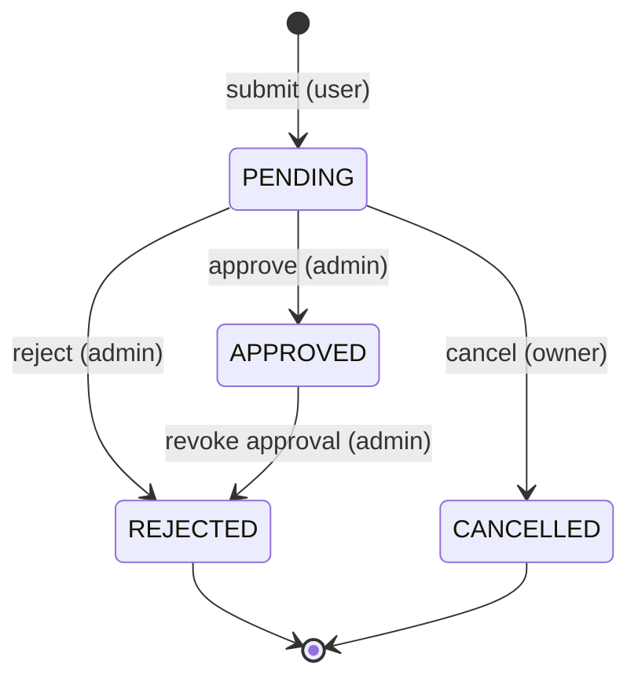
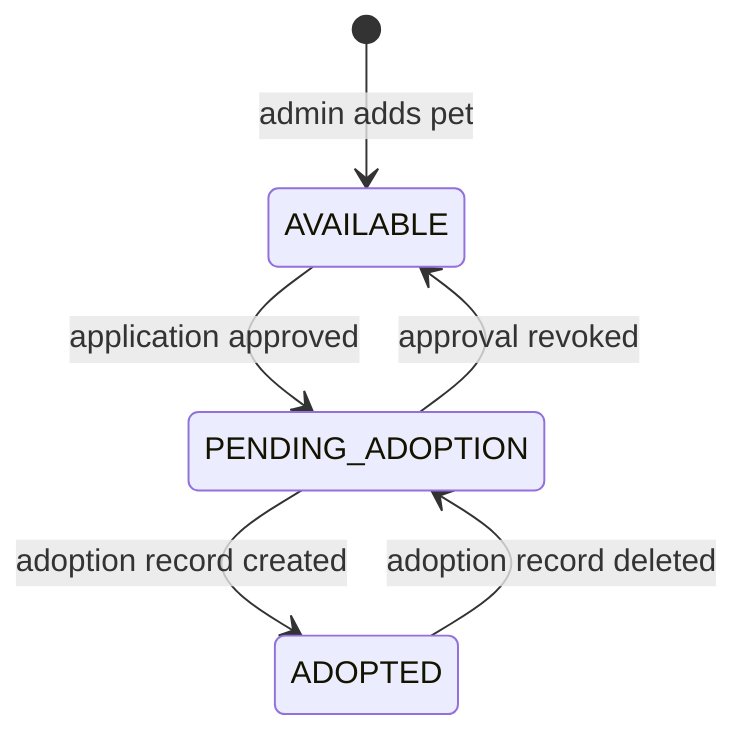

# Business rules

Status flows, side effects, delete rules, and role access. Most of these come from Proposed ADRs in
[DECISIONS.md](DECISIONS.md) — follow them until the group changes them.

Every rule here is enforced in the **service layer** and throws a `PetAdoptionException` subclass when broken.
Menus may hide invalid options, but must not be the only protection.

---

## Application status flow

| From | To | Action | Who | Preconditions | Side effects |
|---|---|---|---|---|---|
| — | `PENDING` | Submit | Regular User | Pet is `AVAILABLE`; no `PENDING`/`APPROVED` app by this user for this pet; user has < 3 `PENDING` apps | `applicationDate` = today |
| `PENDING` | `APPROVED` | Approve | Admin | Pet is `AVAILABLE` | Pet → `PENDING_ADOPTION`; every other `PENDING` app for this pet → `REJECTED` with reason "Pet already has an approved adopter" (ADR-013); `decisionDate` = today |
| `PENDING` | `REJECTED` | Reject | Admin | Reason required (ADR-028) | `decisionDate` = today, `decisionReason` stored |
| `PENDING` | `CANCELLED` | Cancel | Owner (Regular User) | Confirmation `y` | `decisionDate` = today |
| `APPROVED` | `REJECTED` | Revoke approval | Admin | No adoption record exists for this app; reason required (ADR-015) | Pet → `AVAILABLE` |

Every other transition throws `InvalidStatusTransitionException`, for example:
- Approving, rejecting, or cancelling a non-`PENDING` application.
- Editing a non-`PENDING` application.
- An admin cancelling an application (only the owner cancels).
- Any change to a `REJECTED` or `CANCELLED` application (both are final).

**Encapsulation rule:** `AdoptionApplication` has no public `setStatus`. Status changes only through
`approve()`, `reject(String reason)`, `cancel()`, and `revokeApproval(String reason)`. Each method checks the
current status and throws `InvalidStatusTransitionException` itself.

---

## Pet status flow

| From | To | Trigger | Owner of the trigger |
|---|---|---|---|
| — | `AVAILABLE` | Admin adds a pet | Julyan |
| `AVAILABLE` | `PENDING_ADOPTION` | Application approved | Ace calls `PetService` |
| `PENDING_ADOPTION` | `ADOPTED` | Adoption record created | Derick calls `PetService` |
| `PENDING_ADOPTION` | `AVAILABLE` | Approval revoked | Ace calls `PetService` |
| `ADOPTED` | `PENDING_ADOPTION` | Adoption record deleted | Derick calls `PetService` |

### Manual pet status update

Admin "Update Pet Status" (Julyan) is allowed only when the new status matches the data (ADR-014):

| New status | Allowed only if |
|---|---|
| `AVAILABLE` | Pet has no `APPROVED` application and no adoption record |
| `PENDING_ADOPTION` | Pet has an `APPROVED` application and no adoption record |
| `ADOPTED` | Pet has an adoption record |

Otherwise throw `InvalidStatusTransitionException` with a message explaining which action to use instead
(e.g. "Approve an application to move this pet to Pending Adoption."). Setting the same status again is a
`ValidationException` ("Pet is already Available.").

---

## Adoption record rules (Derick)

- **Create:** admin picks an application that is `APPROVED` and has no record yet. The pet must be
  `PENDING_ADOPTION`. Adoption date defaults to today; it cannot be in the future or before the
  `applicationDate`. Effect: pet → `ADOPTED`.
- **Update:** only `adoptionDate` and `notes` (ADR-021). Same date rules.
- **Delete:** confirmation required. Effect: pet → `PENDING_ADOPTION`. The application stays `APPROVED`.
- One record per application. Creating a second one throws `DuplicateRecordException`.

---

## Delete rules

| Record | Delete allowed when | Otherwise | Confirmation |
|---|---|---|---|
| Pet | No applications of **any** status and no record reference it (ADR-022) | `InvalidStatusTransitionException`: "Pet has adoption history. Update its status instead." | Yes |
| User | No applications and no records reference it; not the current admin; not the last active admin (ADR-023) | Message suggests disabling instead | Yes |
| Application (admin "delete invalid") | Status is `PENDING`, `REJECTED`, or `CANCELLED` | `APPROVED` cannot be deleted | Yes |
| Application (user "cancel") | Status is `PENDING` — this is a status change, not a removal (ADR-008) | `InvalidStatusTransitionException` | Yes |
| Adoption record | Always (admin), for mistakes | — | Yes |

Deleting a `PENDING` application never changes the pet's status (only approval does).

## Account rules

- Registration always creates a `RegularUser` with status `ACTIVE`.
- Admin "Add user" may create a `RegularUser` or an `Admin` (ADR-023). Same validation as registration.
- Role never changes after creation.
- `DISABLED` users cannot log in ("This account is disabled. Please contact an administrator.").
- An admin cannot disable or delete their own account, and cannot disable or delete the last `ACTIVE` admin.
- Disabling a user does **not** change their applications. Admins decide those separately.
- Changing one's own password requires the current password (ADR-030).

## Login rules

- Input: username **or** email (case-insensitive) + password (case-sensitive).
- Wrong username/email or wrong password → the same message: "Invalid username/email or password." (Do not
  reveal which part was wrong.)
- 3 failed attempts in a row → back to the welcome menu (ADR-027).
- On success, `SessionManager` stores the user; the role decides `UserMenu` or `AdminMenu`.
- Logout clears the session and returns to the welcome menu.

---

## Menu behaviour on empty or blocked actions

- **No pets to read.** Every menu option that reads pet records prints `[INFO] No pets listed yet.` and returns
  before asking for any input when the current user has no pet to see (Admins: no pets at all; Regular Users:
  no Available or Pending Adoption pet). Covers Browse Pets options 1–4, Manage Pets options 1, 2, 4, 5, 6, 7,
  and My Applications → Apply for a pet. Add Pet is not blocked.
- **No applications to read.** My Applications options 2–5 print `[INFO] No applications applied yet.` when the
  logged-in user has no applications. Manage Adoption Applications options 1–7 print
  `[INFO] No applications submitted yet.` when nobody has applied. Apply for a pet is not blocked.
- **Fail before the form, not after.** When an action is not allowed (apply for a pet you can't apply for,
  delete a pet/user with history, a blocked status change, disabling yourself or the last admin), the menu
  runs the service's `check…` method first, so the error shows before any form fields or the "Are you sure?"
  prompt. The service still re-checks when the action runs.
- Taken emails/usernames, future or too-early dates, and password mismatches are rejected at the prompt and
  re-asked, not after the whole form.

## Role access

| Feature | Regular User | Admin | Owner (member) |
|---|---|---|---|
| Register | ✓ | — (uses "Add user") | Kurt |
| Login / logout | ✓ | ✓ | Kurt |
| View/update own profile | ✓ | ✓ | Derick |
| Browse pets, Pet Passport | ✓ (`AVAILABLE` + `PENDING_ADOPTION` only, ADR-020) | ✓ (all) | Julyan |
| Search/filter pets | ✓ | ✓ | Julyan |
| Submit / update / cancel application | ✓ (own) | ✗ (ADR-024) | Ace |
| View applications | Own only | All | Ace |
| Approve / reject / revoke / delete application | ✗ | ✓ | Ace |
| Own adoption history | ✓ | ✗ (ADR-024) | Derick |
| Manage pets + pet status | ✗ | ✓ | Julyan |
| Manage users (CRUD, disable) | ✗ | ✓ | Derick |
| Manage adoption records, full history | ✗ | ✓ | Derick |
| Statistics | ✗ | ✓ | Derick |

**Ownership checks:** a Regular User can only read or change their own profile, applications, and history.
When a Regular User asks for another user's application or record by ID, throw `RecordNotFoundException`
("Application APP0007 not found."), not `UnauthorizedAccessException`, so the app never confirms that other
users' IDs exist. `UnauthorizedAccessException` is for role violations (a Regular User reaching an admin-only
service method).
